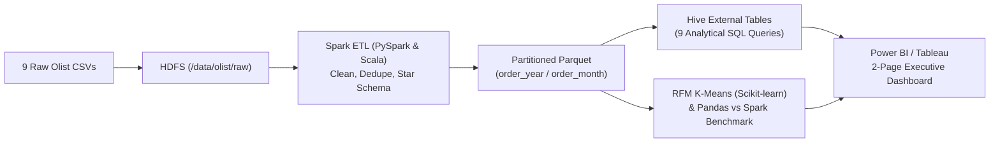
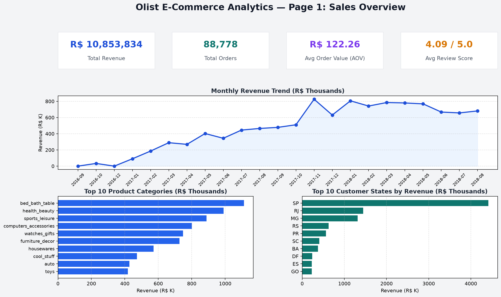
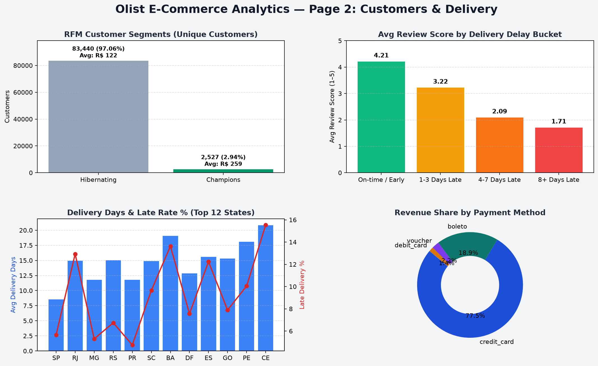
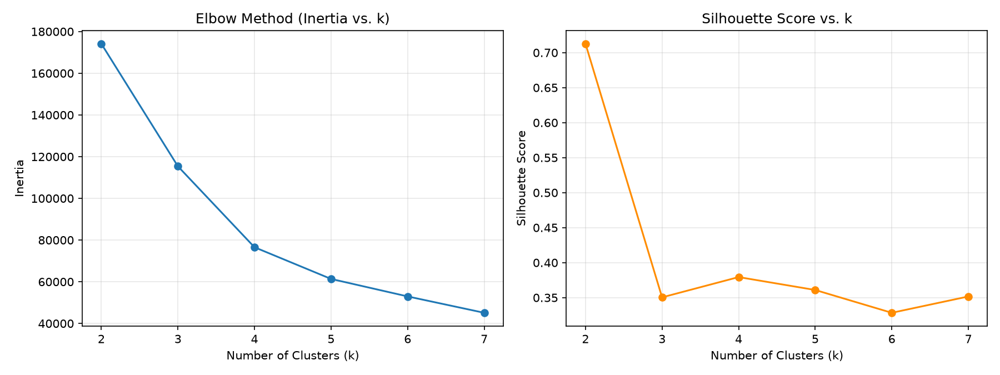

# E-Commerce Sales Analytics Pipeline (Olist Brazilian E-Commerce)

End-to-end batch data engineering and analytics pipeline built on the [Olist Brazilian E-Commerce dataset](https://www.kaggle.com/datasets/olistbr/brazilian-ecommerce) (~100k orders across 9 relational CSVs).

## Problem Statement
E-commerce operations teams need unified visibility into revenue growth, category performance, regional delivery bottlenecks, customer review drivers, and customer lifetime value. Raw transactional exports are fragmented across 9 tables with dirty timestamps, duplicate geolocation records, and extreme freight/price outliers. This pipeline ingests raw CSVs into HDFS, transforms them into a clean star-schema Parquet warehouse using Spark (PySpark & Scala), exposes analytical SQL views via Hive, benchmarks Spark vs. Pandas at 1x/10x scale, segments customers via RFM K-Means clustering, and feeds a 2-page Power BI dashboard.

## Architecture



## Tech Stack
- **Storage:** Hadoop HDFS (`3.2.4`)
- **Processing:** Apache Spark (`4.2.0` — PySpark & Scala `2.13`)
- **Data Warehouse & SQL:** Apache Hive (`4.2.0`)
- **ML & Benchmarking:** Python (`3.14`), Pandas, Scikit-learn, Matplotlib
- **BI & Visualization:** Power BI Desktop / Service (Tableau Public fallback on macOS)

## Project Structure
```text
├── data/
│   ├── raw/                  # Local raw CSVs (git-ignored)
│   └── processed/            # Local Parquet outputs if run locally (git-ignored)
├── scripts/
│   └── ingest_to_hdfs.sh     # Validates & uploads 9 CSVs to HDFS
├── spark_jobs/
│   ├── schemas.py            # Explicit StructType schemas
│   ├── olist_etl.py          # Main PySpark ETL job
│   ├── benchmark_pandas_vs_spark.py
│   ├── rfm_segmentation.py   # RFM + K-Means + Elbow/Silhouette
│   ├── export_dashboard_csvs.py
│   └── scala/
│       ├── build.sbt
│       └── OlistEtlJob.scala # Scala equivalent of the ETL job
├── hive/
│   ├── 01_create_tables.hql
│   └── 02_analytical_queries.hql
├── dashboard/
│   └── powerbi_design.md     # 2-page visual + DAX blueprint
├── docs/
│   └── resume_bullets.md
├── requirements.txt
└── README.md
```

## How to Run

### 1. Install Python dependencies
```bash
pip3 install -r requirements.txt
```

### 2. Download data & ingest into HDFS
Unzip the 9 Kaggle CSVs into `data/raw/`, start HDFS (`start-dfs.sh`), and run:
```bash
bash scripts/ingest_to_hdfs.sh data/raw
```

### 3. Run Spark ETL (PySpark)
```bash
spark-submit spark_jobs/olist_etl.py \
  --input-base hdfs://localhost:9000/data/olist/raw \
  --output-base hdfs://localhost:9000/data/olist/processed
```
*(Or test locally without HDFS using `--input-base data/raw --output-base data/processed`.)*

### 4. Create Hive External Tables & Run Analytical Queries
```bash
hive -f hive/01_create_tables.hql
hive -f hive/02_analytical_queries.hql
```

### 5. Run Performance Benchmark (Pandas vs. Spark)
```bash
spark-submit spark_jobs/benchmark_pandas_vs_spark.py \
  --fact-path hdfs://localhost:9000/data/olist/processed/fact_order_items
```

### 6. Run RFM Segmentation & Export Dashboard CSVs
```bash
spark-submit spark_jobs/rfm_segmentation.py \
  --fact-path hdfs://localhost:9000/data/olist/processed/fact_order_items
spark-submit spark_jobs/export_dashboard_csvs.py \
  --fact-path hdfs://localhost:9000/data/olist/processed/fact_order_items
```

## Pandas vs. Spark Benchmark Results
Measured on Apple Silicon (macOS, local mode) aggregating `order_value`, `order_id`, `delivery_days`, `is_late_delivery`, and `review_score` by `(order_year, order_month, customer_state, product_category)`:

| Scale | Rows | Pandas (s) | Spark (s) | Speedup (Pandas/Spark) |
| :--- | ---: | ---: | ---: | ---: |
| 1x (Full Olist) | 103,892 | 0.0493 | 0.5314 | 0.09x |
| 10x (Duplicated) | 1,038,920 | 0.2609 | 1.9227 | 0.14x |

> **Engineering takeaway:** On single-node in-memory data up to ~1M rows, vectorized Pandas outperforms Spark due to Spark's JVM task-scheduling and shuffle overhead. However, the relative gap narrows as data grows 10x (`0.09x` -> `0.14x`), and Spark scales horizontally across nodes once datasets exceed single-machine RAM.

## Key Business Insights
1. **Delivery Delays Cut Reviews by 2.50 Stars:** On-time/early orders (`82,100`) average **4.21** stars, while orders `8+ days` late (`2,433`) plunge to **1.71** stars (`1–3 days`: `3.22`, `4–7 days`: `2.09`).
2. **Black Friday Peak:** Across `88,778` delivered orders (**R$ 10,853,833.63** revenue, **R$ 122.26** AOV, **4.09** avg review, **7.72%** late rate), **Nov 2017** peaked at **R$ 825,312.48** (`6,723` orders, **+61.72% MoM**).
3. **Regional Bottlenecks:** `SP` drives **40.65%** of revenue (`R$ 4,412,062.45`, `8.56` avg days, `5.65%` late), whereas `RJ` (`12.93%` late, `14.93` days) and `BA` (`13.63%` late, `19.08` days) average **3.88** review scores.
4. **Retention Opportunity (`2.94%` Repeat Rate):** RFM K-Means (`85,967` customers, `k=2`, silhouette `0.7127`) identifies **2,527 Champions** (`2.94%` of customers, `2.11` avg orders, `R$ 258.76` avg spend) driving **6.02%** of revenue, vs. **83,440 Hibernating** one-time buyers (`97.06%`).
5. **Top Category & Payment Mix:** `bed_bath_table` leads (`R$ 1,112,734.01`, `10.25%` share), and `credit_card` accounts for **77.50%** of revenue (`3.43` avg installments).

## Dashboard & Visualizations
Open the interactive 2-page dashboard locally:
```bash
open dashboard/index.html
```
*(Power BI Desktop blueprint: [`dashboard/powerbi_design.md`](dashboard/powerbi_design.md) · DAX measures: [`dashboard/dax_measures.dax`](dashboard/dax_measures.dax))*

### Page 1 – Sales Overview


### Page 2 – Customers & Delivery


### RFM Clustering Diagnostics (Elbow & Silhouette)


## Future Work
- Orchestrate the daily/weekly batch pipeline with **Apache Airflow**.
- Add automated data quality checks with **Great Expectations** or **Deequ**.
- Stream real-time order events with **Kafka + Spark Structured Streaming**.

